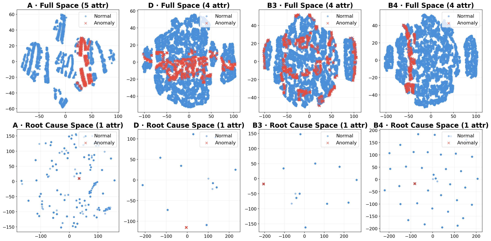

# Prism

Prism (**PR**ecision-driven **I**terative **S**earch for **M**ulti-dimensional root cause localization) is a root cause localization algorithm for multi-dimensional alarm data. Given a set of anomalous data points, Prism identifies the attribute combinations (e.g., `region=Shanghai & service=payment`) that best explain the anomalies.

## Method Overview

Prism formulates root cause localization as an optimization problem over attribute selection weights:

1. **Data Encoding** — Categorical attributes are integer-encoded and stored in a `Table` structure alongside value frequency statistics.
2. **Distance Matrix Construction** — Pairwise distance matrices are computed between anomaly-anomaly and normal-anomaly data points across all attributes.
3. **Gradient-based Attribute Selection** — An RMSProp optimizer learns per-attribute weights by jointly maximizing precision (separability from normal data) and recall (coverage of anomaly data), with a sparsity penalty to prefer fewer attributes.
4. **Combinatorial Refinement** — The top candidate attributes are exhaustively evaluated to find the weight vector that best balances precision and recall.
5. **Iterative Root Cause Discovery** — The algorithm iteratively removes explained anomalies and repeats the search to discover multiple independent root causes.

## Project Structure

```
.
├── algorithm.py              # Core Prism class, Table, RMSProp optimizer
├── experiment_nfc.py         # PrismNFC: variant with statistical noise filtering
├── experiment_psqueeze.py    # PrismSqueeze: variant for PSqueeze benchmark
└── utils.py                  # Data I/O, sampling, and plotting utilities
```

## Requirements

- Python 3.10+
- numpy
- pandas
- loguru
- matplotlib
- PyYAML

## Quick Start

```python
import pandas as pd
from experiment_nfc import PrismNFC

# Load from a preprocessed data directory
model = PrismNFC("data/nfc/")

# anomaly_index: list of row indices flagged as anomalous
results = model(anomaly_index)

for r in results:
    print(r["pred"])     # e.g., {"region": "Shanghai", "service": "payment"}
    print(r["indices"])  # row indices explained by this root cause
```

## Evaluation

### NFC Dataset

```bash
python experiment_nfc.py
```

### PSqueeze Benchmark

```bash
python experiment_psqueeze.py
```

Both scripts compute micro-averaged Precision, Recall, and F1 over all test cases.

### t-SNE Visualization on Public Benchmarks

Below is a t-SNE projection of public benchmark datasets, illustrating how Prism's learned attribute representations separate anomalous patterns from normal ones in the embedding space:



## License

MIT
